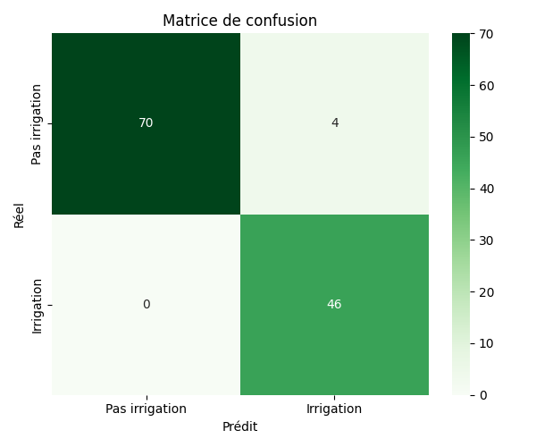

#  Automated Smart Irrigation System (`irrigation_api`)

An end-to-end **IoT and Machine Learning** REST API built with **Python (FastAPI)** and **Scikit-Learn** to automate agricultural irrigation decisions based on real-time environmental sensor telemetry.

---

###  Overview

Water scarcity and inefficient manual watering remain major challenges in agriculture. This project integrates an **ESP32 microcontroller** (collecting soil moisture, ambient temperature, and reservoir water-level readings) with a lightweight **FastAPI** backend. Incoming sensor data is evaluated by a trained **Logistic Regression classifier (`irrigation_model.pkl`)** paired with an independent deterministic safety failsafe to trigger or halt irrigation automatically.

---

###  System Architecture & Repository Structure

```text
irrigation_api/
├── main.py                  # FastAPI application entry point & REST endpoints
├── ia_model.py              # Model inference logic & deterministic safety failsafe
├── entrainer_modele.py      # Scikit-Learn training pipeline & evaluation script
├── generer_dataset.py       # Synthetic sensor dataset generator
├── dataset.csv              # Training & validation dataset
├── irrigation_model.pkl     # Serialized Logistic Regression model
├── matrice_confusion.png    # Confusion matrix evaluating model classification performance
├── database.py              # SQLite database connection & telemetry logging
├── irrigation.db            # Local SQLite database storing sensor history & decisions
├── dashboard.html           # Web supervision dashboard for real-time monitoring
├── mobile.html              # Responsive mobile interface (PWA-ready)
├── manifest.json & sw.js    # Progressive Web App (PWA) configuration & service worker
└── lancer_ngrok.py          # Tunneling helper script for external ESP32 testing
```

---

###  Key Features

* **Machine Learning Inference (`ia_model.py`):** Predicts optimal irrigation actions (`ON` / `OFF`) from multi-sensor inputs using a Scikit-Learn Logistic Regression model.
* **Deterministic Safety Failsafe:** Overrides model predictions if critical thresholds are breached (e.g., empty water tank or maximum soil saturation) to protect hardware and prevent water waste.
* **Real-Time Telemetry Persistence (`database.py`):** Logs all sensor readings, model predictions, and pump states into a structured SQLite database (`irrigation.db`).
* **Web & Mobile Supervision (`dashboard.html` / `mobile.html`):** Interactive Progressive Web App (PWA) dashboard allowing farmers or administrators to monitor field conditions and override controls remotely.

---

###  Model Evaluation

The model is trained via `entrainer_modele.py` on environmental features (soil moisture, temperature, water level) and evaluated using a confusion matrix (`matrice_confusion.png`) to minimize false-positive watering events and ensure reliable crop hydration.



---

###  Quick Start

#### 1. Clone the repository
```bash
git clone https://github.com
cd irrigation_api
```

#### 2. Install dependencies
```bash
pip install fastapi uvicorn scikit-learn pandas numpy joblib
```

#### 3. (Optional) Regenerate dataset and retrain the model
```bash
python generer_dataset.py
python entrainer_modele.py
```

#### 4. Run the FastAPI server
```bash
uvicorn main:app --host 0.0.0.0 --port 8000 --reload
```
Once running, access the interactive API documentation (Swagger UI) at `http://localhost:8000/docs` or open `dashboard.html` to view the monitoring interface.

---

###  Author

**Nafissatou Gaye**  
B.Sc. in Telecommunications & Networks — ESTM Dakar  
